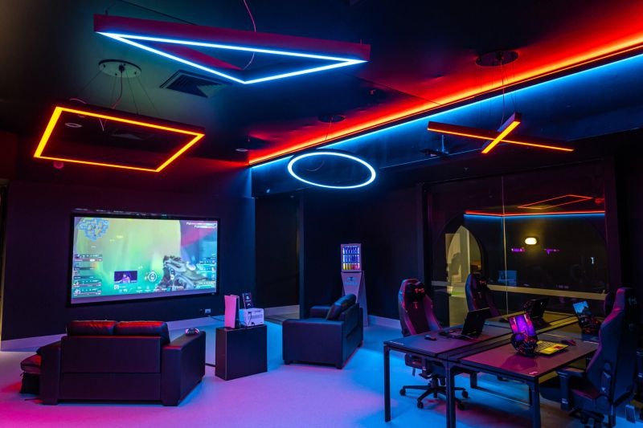
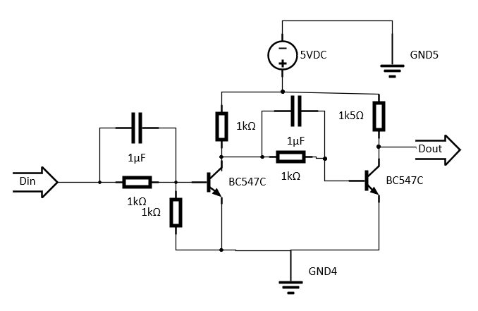
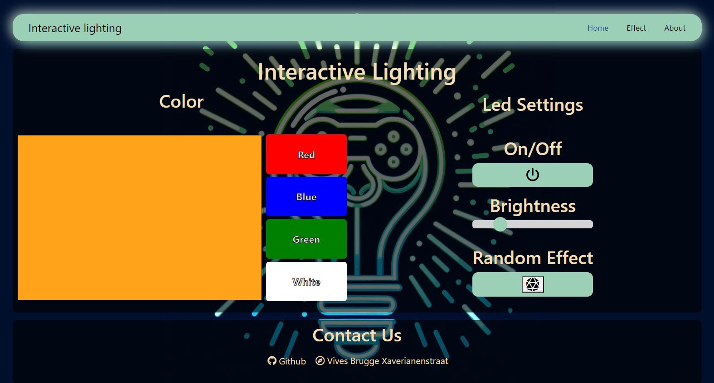
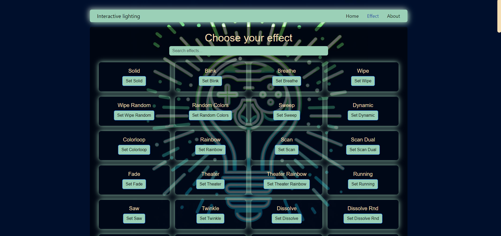
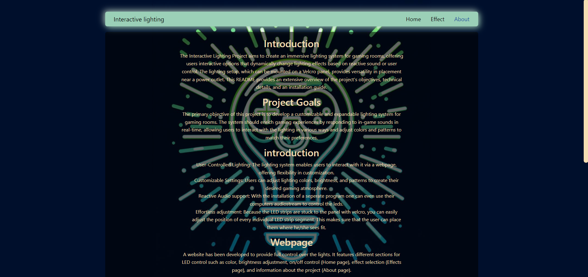

# Interactive Lighting

## Table of Contents

- [Introduction](#introduction)
- [Project Goals](#project-goals)
- [Features](#features)
- [Technical Overview](#technical-overview)
     - [Software](#software)
     - [Hardware](#hardware)
- [User Interface](#user-interface)
     - [Webpage](#webpage)
          - [Home Page](#home-page)
          - [Effect Page](#effect-page)
          - [About Page](#about-page)
          - [Reactive Sound Integration](#reactive-sound-integration)
- [Installation and Setup](#installation-and-setup)
- [End Conclusion](#end-conclusion)
- [Members](#members)

## Introduction

The Interactive Lighting Project aims to create an immersive lighting system for gaming rooms, offering users interactive options that dynamically change lighting effects based on reactive sound or user control. The lighting setup, which can be mounted on a Velcro panel, provides versatility in placement near a power outlet. This README provides an extensive overview of the project's objectives, technical details, and an installation guide.

## Project Goals

The primary objective of this project is to develop a customizable and expandable lighting system for gaming rooms. The system should enrich gaming experiences by responding to in-game sounds in real-time, allowing users to interact with the lighting in various ways and adjust colors and patterns to match their preferences.

## Features

- User-Controlled Lighting: The lighting system enables users to interact with it via a webpage, offering flexibility in customization.
- Customizable Settings: Users can adjust lighting colors, brightness, and patterns to create their desired gaming atmosphere.
- Reactive Audio support: With the installation of a seperate program one can even use their computers audiostream to control the leds.
For more info look [here](documentation/AudioReactivity.md)
- Effortless adjustment: Because the LED strips are stuck to the panel with velcro, you can easily adjust the position of every individual LED strip segment. This makes sure that the user can place them where he/she sees fit.

## Technical Overview

### Software

- **WLED:** This versatile software library controls LED strips, providing a range of effects and customization options.
- **VoiceMeeter** This program is used to reroute the audio output of your device to a virtual input so it can be used to control the leds
- **Fusion 360:** Used for designing and prototyping the physical components of the lighting system.
- **Visual Studio Code:** Utilized for writing the code for the online interface.
- **LedFx:** A network-based LED effect engine designed to deliver advanced real-time audio effects to various devices.
- **Voicemeeter:** Voicemeeter is a software tool that acts like a mixer for audio. It includes a virtual audio device which can be used to mix and control various audio sources coming from or going to different devices or software applications.
- **Docker:** Employed for containerization, Docker streamlines deployment and ensures consistent performance across various environments, enhancing the scalability and reliability of the lighting system.

### Hardware

- **ESP Decice** A powerful microcontroller providing ample processing power and connectivity options. For more information of which ones can be used please look in the installation readme
- **24V Power Supply:** Supplies power to the LED strips and other components.
- **DC/DC Converter:** Ensures efficient power conversion and regulation.
- **WS2812 LED Strips:** Addressable LED strips capable of displaying a wide range of colors and patterns.
- **Ceiling Mounting Hardware:** Initially considered for mounting the LED strips but replaced with a Velcro panel for easier installation and flexibility.
- **JST Connectors:** Facilitate easy connection and disconnection of components.
- **Velcro:** Offers a versatile mounting solution for attaching the LED strips to a panel or surface, enabling flexible placement.

## Level Shifter Documentation ##

## Electrical Scheme ##

## User Interface

The user interacts with the LEDs through a webpage. They can control colors, settings, and effects. We provided a feature so that the user can choose for an reactive sound interegation.

### Webpage

A website has been developed to provide full control over the lights. It features different sections for LED control such as color, brightness adjustment, on/off control (Home page), effect selection (Effects page), and information about the project (About page).

#### Home Page

This page allows control of the general LED settings. Users can adjust the solid color, brightness, and turn the lights on or off. There's a left side with a color picker and buttons for predefined colors, and a right side with controls for power and brightness, as well as a button for random effects.

#### Effect Page

Here, users can choose from a variety of effects available in WLED. They can either search for specific effects or browse through the entire list to select one, enabling them to create a unique gaming atmosphere.

#### About Page

This page provides detailed information about the project's goals, features, and technical specifications. It's intended for informational purposes only and does not offer LED control.

### Reactive Sound Integration

To enhance the gaming experience, sound integration has been implemented. For this we use LedFx and voicemeeter to send it true.

#### LedFx

LedFx was chosen for sound integration as it takes audio input and converts it into real-time light effects for LEDs.

#### Voicemeeter

Voicemeeter is a software tool that acts like a mixer for audio. It includes a virtual audio device which can be used to mix and control various audio sources coming from or going to different devices or software applications. We use it to send the sound from the application true mqtt.

### Customizable Setup

The system is placed on an velcro board. To connect the leds we have JST connectors. Because of this we can customize the setup of the led strips and change how it looks.
We used Autodesk Fusion to make 3d printed corners to get a more aesthetic look.

## Installation and Setup

First complete the [hardware](/documentation/installationHardware.md) installation guide and then complete the [software](/documentation/installationSoftware.md) guide.

## Usage Guide

For the usage guide it is best to first read and complete the [Installation and Setup](#installation-and-setup) guide
The website offers easy-to-use controls. The LED strips can be easily rearranged thanks to Velcro and JST connectors, allowing for various setup options.

## End Conclusion

## Members

- Ibe Packo
- Lennart Fonteyne
- Yarno Otte
- Joren Vandewalle
